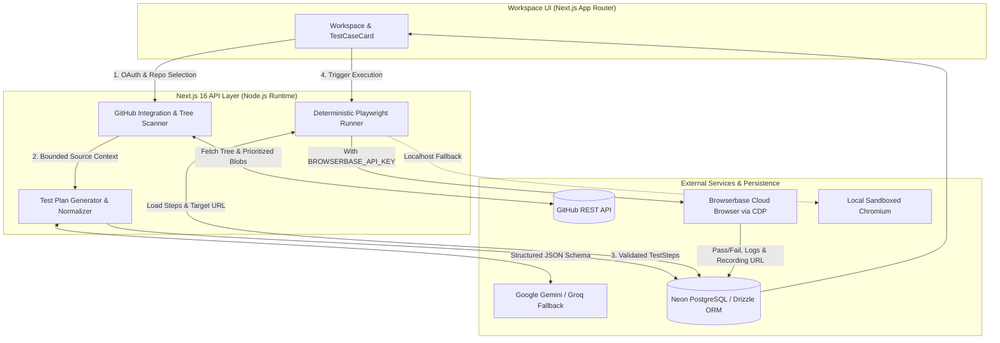

# AI Code Test


**AI Code Test** is a full-stack QA automation platform that inspects GitHub repositories, derives structured end-to-end browser test plans using LLMs, and executes them deterministically in isolated cloud browsers (Browserbase) with session recordings—or locally via a sandboxed Chromium runner.

---

## Table of Contents

- [Architecture & Execution Flow](#architecture--execution-flow)
- [Engineering & Security Highlights](#engineering--security-highlights)
- [Project Structure](#project-structure)
- [Database Schema](#database-schema)
- [API Endpoints](#api-endpoints)
- [Getting Started](#getting-started)
- [Roadmap](#roadmap)

---

## Architecture & Execution Flow



---

## Engineering & Security Highlights

- **Zero Arbitrary Code Execution:** Unlike tools that `eval()` LLM-generated JavaScript, AI Code Test compiles test plans into a strict declarative JSON DSL (`navigate`, `click`, `fill`, `expectText`, `expectVisible`). The runner maps these actions directly to Playwright calls.
- **Accessibility-First Locators:** Interactions target semantic ARIA roles (`button`, `link`, `textbox`, `checkbox`, `radio`, `heading`, `combobox`, `option`) and accessible names (`getByRole`), keeping generated tests resilient against CSS/DOM refactors.
- **SSRF & Local Sandbox Protection:** When `BROWSERBASE_API_KEY` is omitted, the local fallback runner strictly restricts target URLs to loopback hosts (`localhost`, `127.0.0.1`, `::1`) and intercepts/aborts outbound third-party network requests.
- **Context-Budgeted Repository Scanning:** The GitHub scanner filters out lockfiles, build artifacts, and test suites, prioritizing entry points (`README.md`, `package.json`, `app/` / `src/` / `pages/` routes) within strict per-file and total character budgets.
- **Route Normalization & Multi-Model Fallback:** Automatically normalizes file-system paths returned by models (e.g., `app/pricing/page.tsx` -> `/pricing`) and falls back across Gemini Flash models (`gemini-3.5-flash-lite`, `gemini-3.5-flash`, `gemini-3.8-flash`, `gemini-3.1-flash-lite`) and optional Groq models.

---

## Project Structure

```text
├── app/
│   ├── api/
│   │   ├── github/                        # OAuth flow, connection status, repo listing & disconnect
│   │   ├── repositories/
│   │   │   ├── route.ts                   # Workspace repository persistence & target URL config
│   │   │   └── [repositoryId]/test-cases/
│   │   │       ├── route.ts               # List & create test cases
│   │   │       ├── generate-test-cases/   # GitHub tree extraction + LLM test generation
│   │   │       └── [testCaseId]/
│   │   │           ├── route.ts           # Update steps/metadata or delete test case
│   │   │           └── run/route.ts       # Browserbase CDP & local Playwright test runner
│   │   └── webhooks/clerk/route.ts        # Clerk user lifecycle synchronization
│   ├── workspace/
│   │   ├── WorkspaceBody.tsx              # Repo switcher, target URL config & batch execution
│   │   └── TestCaseCard.tsx               # Step editor, run logs, status & recording links
│   ├── pricing/ & support/                # Public marketing & support routes
│   └── sign-in/ & sign-up/                # Clerk authentication routes
├── components/
│   ├── GitHubConnectionDialog.tsx         # Repository import modal
│   └── SiteHeader.tsx                     # Navigation & session controls
├── db/
│   ├── index.ts                           # Neon serverless Drizzle client
│   ├── schema.ts                          # PostgreSQL tables & TypeScript types
│   ├── migrations/                        # Drizzle-generated migrations
│   └── manual-migrations/                 # Incremental SQL schema updates (0001–0003)
├── lib/
│   ├── github-auth.ts                     # OAuth token retrieval via Clerk
│   └── test-steps.ts                      # Step type guards, route validation & constants
└── proxy.ts                               # Next.js 16 Clerk auth middleware
```

---

## Database Schema

Managed with **Drizzle ORM** on **Neon Serverless PostgreSQL**:

| Table | Key Columns | Purpose |
| :--- | :--- | :--- |
| `users` | `id`, `clerk_user_id`, `email`, `name` | Multi-tenant user accounts synced via Clerk webhooks |
| `repositories` | `id`, `user_id`, `github_repo_id`, `full_name`, `target_url`, `test_instructions` | Imported repositories, target deployment URLs, and custom AI guidance |
| `test_case` | `id`, `repository_id`, `title`, `test_type`, `priority`, `target_route`, `test_steps` (JSONB), `last_run_status`, `last_run_logs`, `last_run_browserbase_session_url` | Generated test definitions, structured browser steps, execution logs, and cloud recording URLs |

---

## API Endpoints

| Method | Endpoint | Description |
| :--- | :--- | :--- |
| `GET` | `/api/github/repos` | Lists accessible GitHub repositories for the authenticated user |
| `GET` / `POST` | `/api/repositories` | Fetches workspace repositories or imports a new repository |
| `PATCH` | `/api/repositories` | Updates `targetUrl` and `testInstructions` for a repository |
| `POST` | `/api/repositories/[repositoryId]/test-cases/generate-test-cases` | Scans repo source files and generates 5 structured test cases via LLM |
| `PATCH` / `DELETE` | `/api/repositories/[repositoryId]/test-cases/[testCaseId]` | Edits structured `testSteps` or removes a test case |
| `POST` | `/api/repositories/[repositoryId]/test-cases/[testCaseId]/run` | Executes the test case via Browserbase CDP or local Chromium |

---

## Getting Started

### 1. Clone & Install

```bash
git clone [https://github.com/misafir-kh/AI-Code-test.git](https://github.com/misafir-kh/AI-Code-test.git)
cd AI-Code-test
npm install
npx playwright install chromium
```

### 2. Environment Configuration

```bash
cp .env.example .env.local
```

| Variable | Required | Description |
| :--- | :--- | :--- |
| `NEXT_PUBLIC_CLERK_PUBLISHABLE_KEY` | Yes | Clerk frontend publishable key |
| `CLERK_SECRET_KEY` | Yes | Clerk backend secret key |
| `NEXT_PUBLIC_CLERK_SIGN_IN_URL` / `..._SIGN_UP_URL` | Yes | Clerk auth routes (`/sign-in`, `/sign-up`) |
| `NEXT_PUBLIC_CLERK_SIGN_IN_FALLBACK_REDIRECT_URL` / `..._SIGN_UP_...` | Yes | Post-auth fallback redirect URL (`/`) |
| `WEBHOOK_SECRET` | Optional | Clerk webhook signing secret for `/api/webhooks/clerk` |
| `DATABASE_URL` | Yes | Neon PostgreSQL pooled connection string |
| `DATABASE_URL_UNPOOLED` | Optional | Direct Neon PostgreSQL connection string for migrations |
| `NEON_BRANCH` | Optional | Active Neon database branch identifier |
| `GITHUB_CLIENT_ID` | Yes | GitHub OAuth app client ID |
| `GITHUB_CLIENT_SECRET` | Yes | GitHub OAuth app client secret |
| `GITHUB_REDIRECT_URI` | Yes | OAuth callback URL (`http://localhost:3000/api/github/callback`) |
| `GEMINI_API_KEY` | Yes* | Google Gemini API key (*or configure `GROQ_API_KEY`) |
| `GROQ_API_KEY` | Optional | Optional Groq fallback provider key |
| `BROWSERBASE_API_KEY` | Optional | Enables cloud browser runs and session recordings (falls back to local Chromium when omitted) |

### 3. Apply Database Migrations

Apply the SQL migrations in order on your target Neon branch:

1. `db/migrations/0000_add-repository-test-settings.sql`
2. `db/manual-migrations/0001_create_test_case.sql`
3. `db/manual-migrations/0002_add_test_execution_fields.sql`
4. `db/manual-migrations/0003_add_browserbase_session_fields.sql`

> **Note:** Verify the active Neon branch before applying schema changes to production.

### 4. Run Locally

```bash
npm run dev
```

1. Open `http://localhost:3000`, sign in, and navigate to `/workspace`.
2. Connect a GitHub repository and configure its **Target URL** (use a tunnel such as `cloudflared` when testing a local dev server via Browserbase).
3. Click **Tests generieren** to derive structured test cases from your repository.
4. Select one or more tests and click **Test starten** to inspect step-by-step execution logs, pass rates, and Browserbase session recordings.

---

## Roadmap

- [ ] **Resilient AI Client & Strict Zod Schemas:** Shared Gemini client with exponential backoff + jitter for transient `429`/`503` errors and runtime `zod` validation.
- [ ] **Authenticated Target Flows:** Optional Playwright `storageState` injection per repository to test routes behind Clerk/OAuth login walls.
- [ ] **Failure Artifacts & Root-Cause Diagnostics:** Automatic failure screenshots, console/network error capture, and AI-assisted failure explanations in `TestCaseCard`.
